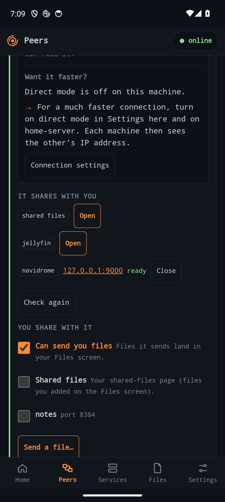
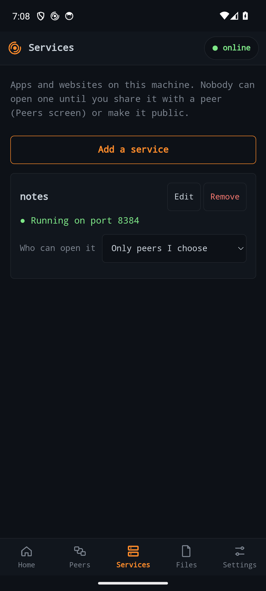

<p align="center"></p>

<h1 align="center">Sol for Android</h1>

**Your phone as a [Sol](https://github.com/apv022/sol) node: open the apps on your own machines
and send them files, over Tor, from anywhere.** No port forwarding, no account, no VPN slot.

[](https://github.com/apv022/sol-mobile/actions/workflows/build.yml)
[](LICENSE)
[](https://github.com/apv022/sol-mobile/releases)


[Website](https://solarae.io/sol-mobile) · [Releases](https://github.com/apv022/sol-mobile/releases) ·
[Design notes](docs/DESIGN.md) · [Sol (desktop and server)](https://github.com/apv022/sol)


| Peers | Services |
|---|---|
|  |  |

> **Alpha (`v0.1.0-alpha.6`).** It runs, installs from a release-signed APK, and is being tested on
> real phones; `v0.1.0` follows a week of that. It has had no independent security review. Expect
> rough edges, and please [report what breaks](https://github.com/apv022/sol-mobile/issues).

## What it is

The app is the same Sol node that runs on your desktop and server, built for Android, with the
same web panel shown full-screen. There is no separate mobile codebase to drift out of step:

- **The node** is the `sol` program from the [main repository](https://github.com/apv022/sol),
  cross-compiled for Android.
- **Tor** is the Tor Project's own Android build, signature-checked when the app is built.
- **The screen** is Sol's panel, served by the node on the phone's loopback address.
- **This repository** is the thin Android shell around them: about 400 lines of Java and one
  build script.

## What you can do with it

- **Pair the phone** with your other machines: in the panel, *Peers → Join with a link*, and
  paste the link from `sol invite` on the other machine.
- **Open a paired machine's apps.** Tap *Open* next to Jellyfin, Navidrome, Home Assistant or
  anything else it shares with the phone. It opens in your browser at `127.0.0.1:<port>`, and
  any app on the phone can use that address too (point the Jellyfin app at it).
- **Send files both ways**, verified by SHA-256 on arrival.
- **Open `sol://pair` links** from other apps: the panel's join screen opens with the link
  filled in, and you confirm there.
- **Keep it running**: the node stays up behind a notification with a *Stop* button. If the node exits for any reason the service did not ask for, the service restarts it (with backoff; it gives up after 15 quick deaths in a row, and opening the app starts it again). It re-checks its connections when the network changes.
- **Save downloads** through the system file picker, and upload files through the file chooser.

## Install

Download `sol-<version>.apk` from the [latest release](https://github.com/apv022/sol-mobile/releases),
open it on the phone, and allow installing from that source when Android asks.

- Needs Android 8.0 or newer and a 64-bit ARM phone (nearly every phone since 2017).
- Releases are signed with a release key by CI on tagged builds, and `SHA256SUMS` is attached.
  Check the signing certificate against this SHA-256 (also in each release's notes):

  ```
  94c19905dcdafc2da652e5b54785b0d9d94bc7a472a032a833973b8db5aa9602
  ```

  `apksigner verify --print-certs sol-<version>.apk` prints it. Android may still warn about an
  unknown developer because the app is not from a store.
- The first `v0.1.0-alpha` build was signed with a debug key: uninstall it once before installing
  a later release, since Android refuses to update across signing keys. Local `./build.sh` builds
  use a per-machine debug key unless you set `SOL_KEYSTORE`, `SOL_KEYSTORE_PASS` and
  `SOL_KEY_ALIAS`.

## Permissions, and why there is no VPN permission

| Permission | Why |
|---|---|
| Internet | Tor, and direct connections to your peers if you turn direct mode on |
| Foreground service | Keeps the node running while the app is in the background |
| Notifications | The "Sol is running" notification Android requires for that |
| Battery optimisation | Asked once, with an explanation, so Android doesn't cut the node off in the background |

Sol does **not** ask for the VPN permission. Android allows one VPN at a time, so taking that
slot would switch off Tailscale, WireGuard, Proton or whatever you already run. Instead, a paired
machine's app appears on a local port of the phone, which every browser and app can reach. The
reasoning and the trade-offs are in [docs/DESIGN.md](docs/DESIGN.md).

## Build it yourself

```sh
git clone https://github.com/apv022/sol-mobile && cd sol-mobile
./build.sh            # -> build/sol.apk
./build.sh test       # unit tests for the service logic (plain JVM, no device)
```

You need Linux (x86-64), `bash`, `curl`, `unzip`, `zip`, `gpg` and Go 1.26+. The script downloads
a JDK, the Android SDK build tools and Tor's Android build into `.toolchain/` (about 1 GB, nothing
installed system-wide), checks Tor against the Tor Project's signing key, and builds without
Gradle or Android Studio. To build against your own checkout of Sol: `SOL_SRC=../sol ./build.sh`.

## Known limits

- **arm64 phones only in releases.** No 32-bit build. `ABIS="arm64-v8a x86_64" ./build.sh` adds an
  x86_64 build for the emulator (the node is a static linux/amd64 binary there; Tor is the
  Tor Project's x86_64 bundle, checked against the same signed checksums). Emulator-only: do not ship it.
- **Battery.** A node that stays reachable keeps a Tor connection open. Stop it from the
  notification when you don't need the phone to be reachable.
- **Android may stop it.** The node and Tor run as child processes of the app, which aggressive
  battery savers and Android 12+'s process limits can kill. If it stops, open the app again, and
  exempt Sol from battery optimisation.
- **No QR scanner yet**: paste the pairing link.
- **Not on Google Play or F-Droid.** The APK from the releases page is the only way to install it.
- **Little real-phone mileage so far.** Built and tested on an API 34 emulator, now on real
  phones. Still being checked: battery use and Doze, switching between Wi-Fi and mobile data,
  Android 12+ refusing a background start, and the panel's width after rotating. The checklist
  is in [docs/DESIGN.md](docs/DESIGN.md#test-on-a-real-phone).

## Security

Read the main project's [threat model](https://github.com/apv022/sol/blob/main/docs/THREAT_MODEL.md);
it applies here unchanged. Phone-specific notes are in [SECURITY.md](SECURITY.md), which also says
how to report a vulnerability.

## License

[Apache-2.0](LICENSE). Tor is distributed under its own
[BSD-style license](https://gitlab.torproject.org/tpo/core/tor/-/blob/main/LICENSE).
